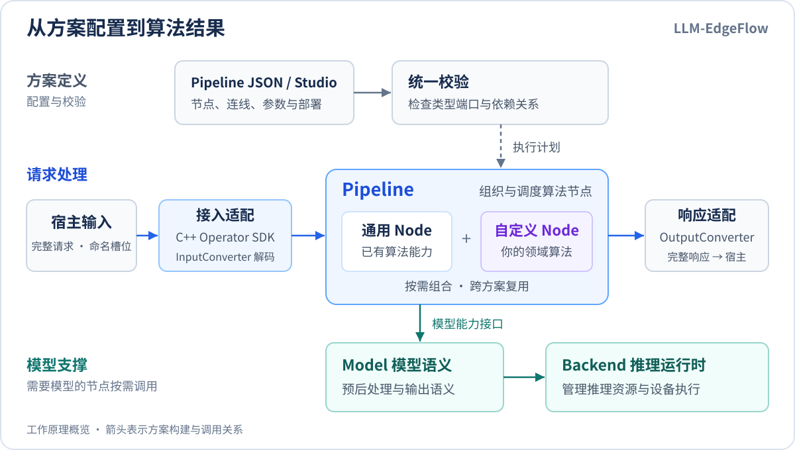
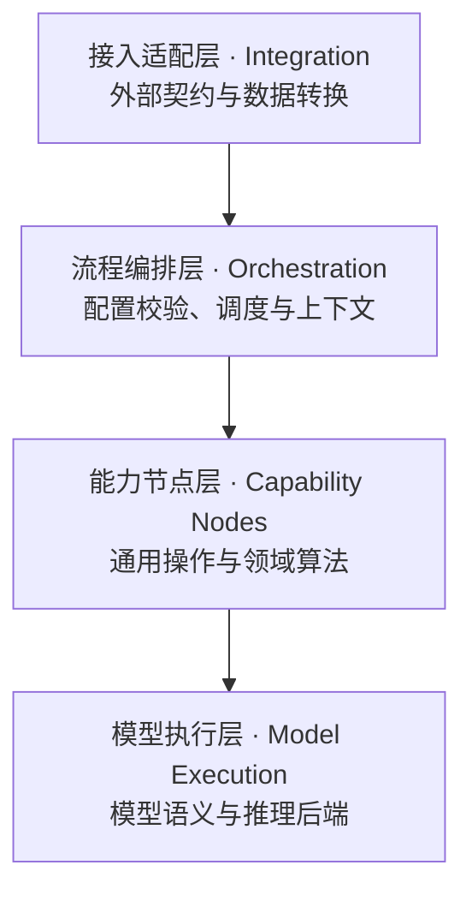

# LLM-EdgeFlow

**面向边缘与端侧应用的 C++ 算法编排框架。**

[](https://github.com/chamsechan/LLM-EdgeFlow/actions/workflows/ci.yml)
[](CMakeLists.txt)
[](LICENSE)

LLM-EdgeFlow 用算法节点处理规则、检索、文本、图像和语音。Pipeline JSON 描述节点之间的连接。宿主程序通过 C++ Operator SDK 调用方案。

项目目前处于实际业务接入前的开发与验证阶段。仓库提供可运行示例和自动化测试。模型效果、性能及目标设备适配需按具体场景验收。

[快速开始](#快速开始) · [架构与扩展](#架构与扩展) · [示例方案](#示例方案) · [开发文档](#开发文档)

## 按任务开始

首次使用时，先完成快速开始。然后按任务选择教程。同一方案可使用多份教程。

| 你要做什么 | 主要修改 | 入口 |
| :--- | :--- | :--- |
| 拉方案：组合已有能力 | Pipeline 配置、规则、提示词与连线 | [Studio 编排练习](tools/pipeline_studio/README.md#第一次编排) · [修改提示词](doc/dev_guide/recipe_prompt_config.md) |
| 开发 Node：补充业务算法 | 普通 C++ 函数、端口声明和测试 | [自定义 Node 入门](doc/dev_guide/first_custom_node.md) |
| 增加 Adapter：接入请求与响应 | 输入/输出转换器，优先复用现有载体 | [业务接入指南](doc/dev_guide/business_onboarding.md) |

<p align="center">
  <a href="doc/assets/framework_overview.svg">
    
  </a>
</p>

## 快速开始

本例使用 Linux CPU 环境。在仓库根目录执行所有命令。
构建需要 C++17 编译器、CMake 3.19+、Ninja、Python 3 和 Git。
首次构建需要联网下载固定版本的依赖。模型权重需单独准备。

### 1. 获取并构建

```bash
git clone https://github.com/chamsechan/LLM-EdgeFlow.git
cd LLM-EdgeFlow

cmake --preset=minimal -B build
cmake --build build --target alg_sdk alg_demo alg_pipeline_tool alg_show --parallel 4
```

此构建可运行无需模型的示例。使用真实模型时按[构建变体](doc/VERIFIABLE_SELECTION.md#构建变体)
启用对应 Backend。主要产物如下：

| 产物 | 用途 |
| :--- | :--- |
| `build/libcompany_alg_sdk.so` | 集成到宿主程序的算法共享库 |
| `build/alg_demo` | 使用统一入口运行示例方案 |
| `build/alg_pipeline_tool` | 查询能力、校验 Pipeline、查看执行计划 |
| `build/alg_show` | 在终端查看 Pipeline 的节点与连线 |

### 2. 运行第一个方案

从无需模型权重的关键词匹配开始。下面使用仓库自带的三条测试文本，执行配置中定义的规则：

```bash
./build/alg_pipeline_tool validate configs/pipeline_keyword_match_rules.json
./build/alg_demo --profile keyword_match_rules \
  --dataset tests/fixtures/effects/keyword_inputs.txt \
  --output-dir results/quickstart
```

预期三条输入均处理成功，第一、三条命中 `SYSTEM_INIT`，第二条未命中。结果位于：

- `results/quickstart/keyword_match_rules/results.jsonl`：逐条请求的状态与匹配结果。
- `results/quickstart/keyword_match_rules/summary.json`：样本数、成功数、失败数与耗时。

`keyword_match_rules` 是 Demo 运行预设。Demo 使用 Pipeline 中的规则。
如需练习运行时更新规则，执行 `./build/alg_demo --profile keyword_match_control`。

### 3. 查看与编辑流程

```bash
# 查询当前构建中可用的业务契约与节点
./build/alg_pipeline_tool catalog
./build/alg_pipeline_tool describe-node text_rule_match

# 查看经过校验的执行计划
./build/alg_pipeline_tool plan configs/pipeline_keyword_match_rules.json

# 打开本地 Web 工作台
./tools/pipeline_studio/server.py configs/pipeline_keyword_match_rules.json --web
```

工作台监听 `127.0.0.1`，支持连线、参数编辑、校验和运行。
接下来，按 [Studio 编排练习](tools/pipeline_studio/README.md#第一次编排)修改规则。用 Demo 验证修改后的方案。

## 架构与扩展

框架按职责划分为四层。通常先复用节点并编写 Pipeline，出现能力缺口后再扩展对应层。



| 职责 | 何时扩展 | 主要入口 |
| :--- | :--- | :--- |
| 接入适配层 | 宿主程序增加新的输入输出结构或调用约定 | `include/adapter/`、`include/edgeflow/operator/`、`src/adapter/` |
| 流程编排层 | 现有校验、调度或上下文机制无法满足需求 | `include/core/`、`src/core/` |
| 能力节点层 | 增加领域算法、数据处理或模型调用组合 | `src/custom_nodes/`；通用操作位于 `src/common_nodes/` |
| 模型执行层 | 增加模型语义或接入新的推理运行时 | `src/engine/models/`、`src/engine/backends/` |

完整职责、编译依赖和运行时数据流见[架构设计](doc/architecture.md)。首次编写算法见[自定义 Node 入门](doc/dev_guide/first_custom_node.md)。

## 一个方案由哪些文件组成

| 文件 | 负责什么 | 示例 |
| :--- | :--- | :--- |
| Pipeline JSON | 节点、依赖、类型端口、模型路径与算法参数；根 `io.input` / `io.output` 声明转换器、响应来源与输出容量 | [pipeline_keyword_match_rules.json](configs/pipeline_keyword_match_rules.json) |
| 部署 `.conf` | 仅用 `pipe_path` 指向 Pipeline JSON | [pipeline_keyword_match_rules.conf](configs/pipeline_keyword_match_rules.conf) |
| Demo Profile（可选） | 运行预设：业务、配置、数据集和批大小等 | [demo/profiles.json](demo/profiles.json) |

Profile 保存运行预设。Demo 参数也可直接指定配置和数据集。
保存新 Pipeline 后，将 `.conf` 指向新文件。步骤见[运行当前方案](tools/pipeline_studio/README.md#运行当前方案)。

## 示例方案

以下配置展示已有能力的组合方式。涉及模型的方案需要匹配的 Backend、权重及运行资源。实际可用的节点、模型和后端以目标构建的 `alg_pipeline_tool catalog` 为准。

| 场景 | 处理方式 | 配置与运行条件 |
| :--- | :--- | :--- |
| 关注词匹配 | 文本规则匹配与分类 | [配置](configs/pipeline_keyword_match_rules.json)；无需模型权重 |
| 实体抽取 | LLM 生成与结构化结果解析 | [配置](configs/pipeline_entity_extract_cpu.json)；llama.cpp 与匹配的语言模型 |
| 文档问答 | 文本分块、向量检索与 LLM 回答 | [配置](configs/pipeline_doc_qa_default.json)；ONNX Runtime、llama.cpp 与对应模型 |
| 对话合规审核 | 检索、精排与 LLM 分析 | [配置](configs/pipeline_dialogue_audit_default.json)；向量、精排和语言模型 |
| Cross-Encoder 精排 | 对问题与候选文本进行相关性评分 | [配置](configs/pipeline_cross_rerank_cpu.json)；ONNX Runtime 与精排模型 |
| OCR 票据问答 | 票据图像转写后抽取字段并问答 | [配置](configs/pipeline_ocr_invoice_qa_kite.json)；Kite 与视觉、语言模型 |
| 语音识别与意图槽位 | Whisper 转写与规则分类 | [配置](configs/pipeline_audio_asr_intent_cpu.json)；启用 whisper.cpp 并准备语音模型 |
| 翻译 | 完整 JSON 请求中的 `query` 翻译为中文 | [配置](configs/pipeline_translate_cpu.json)；llama.cpp 与语言模型 |

Kite 的图像转写输出文本，不提供检测框或置信度。Kite、Whisper 等可选后端需单独选择构建配置。参考[构建变体与模型资产](doc/VERIFIABLE_SELECTION.md)和 [kiteLLM 接入说明](doc/kitellm.md)。

查看全部 Demo 预设，或运行无需真实模型的 Smoke 套件：

```bash
./build/alg_demo --list
./build/alg_demo --suite smoke
```

Smoke 验证执行链路。真实模型的业务效果需使用目标数据集另行验证，方法见[效果验收](doc/VERIFIABLE_SELECTION.md#业务效果验收)。

## 开发文档

日常业务开发从[按任务开始](#按任务开始)选择教程。遇到具体问题时再查阅以下参考。

| 目标 | 入口 |
| :--- | :--- |
| 理解节点端口、模型绑定与并发 | [Node 常用写法与按需参考](doc/dev_guide/custom_node_concepts.md) |
| 给节点增加运行时控制 | [Control 入门](doc/dev_guide/first_control.md) |
| 扩展框架、模型或后端 | [开发者指南](doc/developer_guide.md) · [架构设计](doc/architecture.md) |
| 准备模型并验证效果 | [模型、构建与效果验收](doc/VERIFIABLE_SELECTION.md) |
| 查看当前未发布基线 | [Changelog](doc/CHANGELOG.md) |
| 查阅全部文档 | [文档目录](doc/README.md) |

## 参与开发

在独立分支上修改，并在交付前执行完整质量门禁：

```bash
./scripts/run_all_tests.sh
```

该命令执行格式检查、静态检查、构建和 CTest 测试。
环境需要 clang-format 18、Java 17+ 和 Python `jsonschema`。
Debian/Ubuntu 的对应 Python 包为 `python3-jsonschema`。
开发流程见 [CONTRIBUTING.md](CONTRIBUTING.md)，测试说明见 [tests/README.md](tests/README.md)，Agent 规则见 [AGENTS.md](AGENTS.md)。

`jsonschema` 需安装在 CMake 选中的 Python 环境中。当前版本 **v11.0.0**，尚未正式发布。变更见 [Changelog](doc/CHANGELOG.md)。

## 许可证

项目采用 [MIT License](LICENSE)。第三方组件及其许可见 [THIRD_PARTY_NOTICES.md](THIRD_PARTY_NOTICES.md)。

仓库目录、源码头文件和命名约定见[源码布局与命名](doc/dev_guide/source_layout.md)。示例配置和 Profile 的组织见[配置目录](configs/README.md)。
