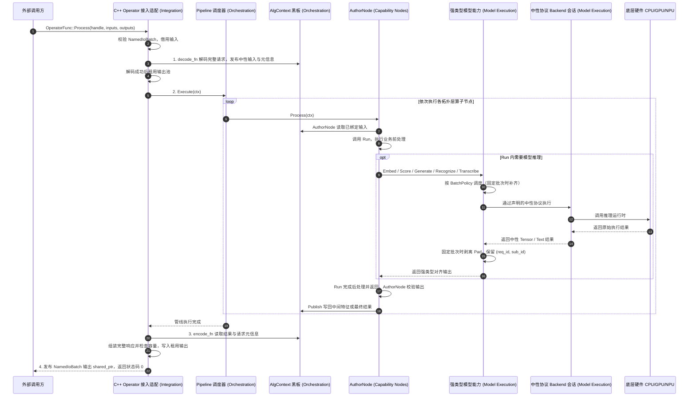

# LLM-EdgeFlow 架构设计

本文说明各层职责、编译依赖和运行时数据流。
Pipeline 组合能力节点。接入适配层处理外部请求和响应。模型执行层提供模型能力和推理后端。

---

## 1. 架构总览

框架采用四层架构，统一按职责命名：**接入适配层 → 流程编排层 → 能力节点层 → 模型执行层**。

| 职责名称 | 英文名称 | 源码归属 | 构建目标 |
| :--- | :--- | :--- | :--- |
| 接入适配层 | Integration | `include/adapter/`、`include/edgeflow/operator/`、`src/adapter/` 及 C++ Operator 接口 | `edgeflow_integration_objects` |
| 流程编排层 | Orchestration | `include/core/`、`src/core/` | `edgeflow_orchestration_objects` |
| 能力节点层 | Capability Nodes | `include/nodes/`、`src/common_nodes/`、`src/custom_nodes/` | `edgeflow_capability_nodes_objects` |
| 模型执行层 | Model Execution | `include/engine/`、`src/engine/` | `edgeflow_model_execution_objects` |

文档、工具诊断和构建目标使用上述职责名称。源码目录按 Adapter、Core、Nodes、Engine 等组件组织。

业务开发先看 [README 工作原理图](../README.md#按任务开始)。下图用于查阅组件实现。
编译依赖由下文的构建边界约束。`include/contracts/` 中的共享运行时契约通过独立的
`edgeflow_runtime_contracts` 提供给实现层，不能将目录名称直接等同于完整编译依赖。

```mermaid
graph TD
    classDef integration fill:#E3F2FD,stroke:#1565C0,stroke-width:2px,color:#0D47A1;
    classDef orchestration fill:#E8F5E9,stroke:#2E7D32,stroke-width:2px,color:#1B5E20;
    classDef capability_nodes fill:#FFF3E0,stroke:#E65100,stroke-width:2px,color:#E65100;
    classDef model_execution fill:#F3E5F5,stroke:#7B1FA2,stroke-width:2px,color:#4A148C;
    classDef ext fill:#ECEFF1,stroke:#37474F,stroke-width:1px,color:#263238;

    subgraph External["外部调用方 (业务APP / 车机系统 / 边缘平台)"]
        Caller["下游集成程序 / 主控服务"]
    end

    %% Integration
    subgraph Integration["接入适配层（Integration）"]
        PlatformFacade["Operator 协议壳 (operator_adapter.cpp)<br>• ABI 参数与命名槽位翻译<br>• 平台 binding 与外部错误码映射<br>• 异常拦截屏障 (noexcept 安全防护)"]
        RuntimeFacade["中立 Runtime (SharedAlgorithmRuntime)<br>• 部署校验、Pipeline 构建与执行<br>• Converter 调度与 Control<br>• 输出池、租约、两阶段发布与执行串行化"]
        Converters["I/O 转换注册 (io_converter_registry.cpp)<br>• 按 (type, name) 选择单槽 Converter<br>• InputConverter：完整请求解析与字段转换<br>• OutputConverter：完整响应组装与容量检查"]
    end

    %% Orchestration
    subgraph Orchestration["流程编排层（Orchestration）"]
        PipeCore["Pipeline 核心调度器 (pipeline.cpp)<br>• 消费 ValidatedPipelinePlan<br>• 算子波前执行与错误熔断"]
        
        subgraph StateMgr["上下文与节点注册"]
            S_Ctx["SessionContext (句柄级持久状态)<br>• ModelManager 多模型池<br>• SessionResourceKey&lt;T&gt; 类型安全缓存"]
            R_Ctx["AlgContext (请求级瞬态黑板)<br>• Read / Publish 不可变快照<br>• 只读视图随请求生命周期稳定"]
            TraceTag["TraceableItem 溯源追踪<br>• req_id (请求索引)<br>• sub_id (1对N分片索引)"]
            Factory["NodeRegistry<br>• 函数式 Node Spec 与 Definition"]
        end
    end

    %% Capability Nodes
    subgraph CapabilityNodes["能力节点层（Capability Nodes）"]
        NodeApi["INode 运行时接口"]
        NodeBase["NodeBase<br>final noexcept 生命周期与 Typed I/O"]
        ModelNode["AuthorNode：统一 Spec 执行<br>InputsOf / OutputsOf / ModelsOf"]
        CustomNodes["自定义节点扩展目录 (src/custom_nodes/)<br>复用现有接口，按操作组织文件"]
        
        subgraph CommonNodes["通用能力算子池 (src/common_nodes/)"]
            LlmNode["llm_generate (大语言模型生成)"]
            ChunkNode["text_chunk (文本切片)"]
            RuleNode["text_rule_match (规则与关键词匹配)"]
            EmbedNode["text_embedding (向量提取)"]
            TopKNode["vector_top_k (Top-K 检索)"]
            RerankNode["text_rerank (精排评分)"]
            TemplateNode["text_template (提示词模板渲染)"]
            JsonNode["structured_json_parse (JSON 结构化解析)"]
            AsrNode["asr_transcribe (语音转写)"]
            OcrNode["ocr_detect (OCR 识别)"]
            CorpusNode["text_corpus_source (语料源)"]
        end
    end

    %% Model Execution
    subgraph ModelExecution["模型执行层（Model Execution）"]
        ModelBase["IModel 强类型能力抽象"]
        BackendBase["IInferenceBackend / IBackendSession<br>中性执行协议"]
        LlmIntf["ILlmModel + ITextGenerationSession<br>(formatted prompt / unified options / text)"]
        EmbedIntf["IEmbeddingModel / IRerankModel<br>TensorGraph / GeneratedTokenEmbedding"]
        
        BatchExec["FixedBatchExecutor (固定 Batch 调度器)<br>• 计算切片与补齐数量<br>• Model 回调构造补齐输入<br>• 推理后剥离补齐输出并恢复溯源标签"]
        
        subgraph ModelSemantics["模型语义实现 (src/engine/models/)"]
            BgeModels["BgeEmbeddingModel / BgeRerankerModel"]
            GeneratedEmbedModel["GeneratedTextEmbeddingModel<br>(generated token pooling / normalization)"]
            QwenModel["QwenCausalLmModel<br>(ChatML / provenance / protocol delegation)"]
            VisionModel["VisionDocumentModel<br>(像素帧预处理与识别指令)"]
            WhisperModel["WhisperAsrModel<br>(音频校验与语言语义)"]
        end

        subgraph HardwareBackends["硬件推理 Backend (src/engine/backends/)"]
            OnnxBackend["OnnxRuntimeBackend<br>(TensorGraph, CPU/CUDA)"]
            LlamaCpp["LlamaCppBackend<br>(TextGeneration, GGUF runtime)"]
            KiteLlm["KiteLlmBackend<br>(Text / ImageText / GeneratedTokenEmbedding, conditional SDK)"]
            WhisperCpp["WhisperCppBackend<br>(AudioTranscription, optional build)"]
        end
    end

    %% 连接关系
    Caller <==|命名 I/O 批次 NamedIoBatch| PlatformFacade
    PlatformFacade --> RuntimeFacade
    RuntimeFacade --> Converters
    RuntimeFacade -->|移交 Pipeline 计划 / 执行与控制| PipeCore
    Converters -->|解包/打包| R_Ctx
    PipeCore --> S_Ctx
    PipeCore --> NodeApi
    NodeApi --> NodeBase
    NodeBase --> ModelNode
    ModelNode -.-> CommonNodes
    ModelNode -.-> CustomNodes
    ModelNode -->|执行时读取输入与发布输出| R_Ctx
    ModelNode -->|初始化时绑定模型能力| S_Ctx
    CommonNodes & CustomNodes -->|调用强类型模型能力| LlmIntf & EmbedIntf
    LlmIntf & EmbedIntf --> ModelSemantics
    ModelSemantics -->|仅依赖中性协议| BackendBase
    BackendBase --> HardwareBackends
    ModelSemantics --> BatchExec

    class Caller ext;
    class PlatformFacade,RuntimeFacade,Converters integration;
    class PipeCore,S_Ctx,R_Ctx,TraceTag,Factory orchestration;
    class NodeApi,NodeBase,ModelNode,CommonNodes,CustomNodes,LlmNode,ChunkNode,RuleNode,EmbedNode,TopKNode,RerankNode,TemplateNode,JsonNode,AsrNode,OcrNode,CorpusNode capability_nodes;
    class ModelBase,BackendBase,LlmIntf,EmbedIntf,BatchExec,BgeModels,GeneratedEmbedModel,QwenModel,VisionModel,WhisperModel,OnnxBackend,LlamaCpp,KiteLlm,WhisperCpp model_execution;
```

---

## 2. 职责与扩展边界

### 接入适配层（Integration）
- **代码位置**：`include/edgeflow/operator/`，`include/adapter/`，`src/adapter/`
- **核心职责**：
  1. 导出基于命名 I/O 槽位的 C++ Operator 门面：`Get_LLM_EDGEFLOW_OperatorTable()`, `GetOperatorLastError()`, `ResolveOperatorConfigIo()`。
  2. 导出公共日志 C API：`AlgBase_setLogLevelByName`, `AlgBase_getLogLevelByName`, `AlgBase_logPrint`。
  3. 函数表指针不带 `noexcept`，实现保留 `noexcept` 和异常捕获屏障，防止 C++ 异常跨越动态库边界。
  4. 由注册的 Input/Output Converter 解包完整外部请求并组装完整外部响应，负责外部契约与内部 `AlgContext` 中立值之间的转换。
  5. 管理有界输出池与租约生命周期，执行同句柄 Process/Control 串行化。

业务需求中的输入输出以 Operator 接口边界为准，包含载体中的业务字段和序列化格式。
Demo 不得提前拆解请求或在 SDK 返回后补组业务响应。内部节点端口不是外部 I/O 契约。
具体职责和判断示例见[输入输出边界](dev_guide/business_onboarding.md)。

#### 统一 Operator 门面与运行时架构

接入适配层通过标准 C++ Operator 门面与共享算法运行时调度算法执行：

```text
外部调用方 → Operator 协议壳 → SharedAlgorithmRuntime → Pipeline (DAG)
                 │                    │
         ABI、载体与错误码翻译     Converter 调度、输出池、租约与整体发布
                 │                    │
外部调用方 ← 平台输出交付 ← RuntimeOutputBatch
```

`SharedAlgorithmRuntime` 是接入适配层内部的中立运行时，不增加公开动态 ABI。
`RuntimeCreateOptions` 提供自有路径、设备和平台名称。`RuntimeInputBatch` 使用类型擦除输入视图，
`RuntimeOutputBatch` 按原始行和输出选择索引申请、接收租约。`ControlRequest` 提供内部命令和 JSON。
Runtime 负责部署校验、`ValidatedIoPlan` 构建、Converter 调度、Pipeline 执行和池生命周期。
内部 `int` 返回值统一引用中立框架码，协议壳映射为平台码。见[错误码与日志](dev_guide/error_handling.md)。

协议壳解析具体 Create/Control 结构及输入输出 key，binding 负责载体校验、像素/字符串复制、
布局分配、容量、重置与释放。Runtime 只调用类型擦除接口，不解释平台字段或所有权细节。
全部输出编码成功后，Runtime 一次发布中立租约。协议壳写入全部平台字段后，再向宿主交付输出。
如果任一步失败，调用方不会收到部分结果。输入和输出按行对应。

通用值类型注册表默认不含平台登记。当前 mock binding 翻译单元自行注册，只有链接该协议实现的
开发构建才提供 mock 载体。更换协议壳和 binding 不需要修改 Core、Node、Model 或 Backend。

- 标准 C++ Operator API（`llm_edgeflow::operator_api`）为唯一公开算法接口，承诺 6 个导出符号（3 个 Operator API 函数与 3 个 AlgBase 日志函数）。Node、Registry、Model、Backend 及第三方运行时符号使用 hidden visibility，不构成稳定动态 ABI。
- 同一 handle 的 `Process` 与 `Control` 串行执行，不同 handle 可并行。
  调用 `Destroy` 前，停止新调用。等待该 handle 的全部调用返回，再释放全部输出引用。
  `Destroy` 返回后，handle 永久失效。`DeInit` 清理全局注册的全部 handle。
  调用 `DeInit` 前，对所有实例执行相同的停止、等待和释放步骤。
  完整规则见[宿主调用与生命周期](dev_guide/operator_output_allocation.md#宿主调用与生命周期)。
- Pipeline 根 `io.input` / `io.output` 按 `(type, name)` 选择单槽转换器。`type` 是宿主 key 后缀，
  `name` 对应结构体业务值。宿主 key 固定为 `<prefix>.<type>`，prefix 由宿主生成、非空且不含 `.`，
  Runtime 不解读也不合成；同一方向内每种 type 至多选用一次。
  平台登记显式声明业务成员。声明了服务成员的载体由 Process 逐行检查服务值，按输入输出 vector 的同一行关联请求，
  不要求载体提供请求 ID。
  转换器类型端口组合成 Core 的必传 I/O 边界，见[输出分配方案](dev_guide/operator_output_allocation.md)。
- 组件调用关系：`外部调用方 → Operator 协议壳 → SharedAlgorithmRuntime → Pipeline → Node → Model → Backend → Platform`。
  `Operator` 表达对外交付的算法实例，`Platform`（`ComputePlatform`）表达底层硬件执行平台（CPU、CUDA、AX650、Ascend 等）。
- 同一业务可以使用一个聚合结构槽位，也可以由多个原子槽位组成。支持多槽位解绑。
- 当前八类业务统一使用 `json_out` 与 `MockOutput` C 结构，完整结果存于嵌套的池化
  `MockTextOutput`，输出结构不暴露状态码，各业务 `name` 选择响应契约。新增其他载体继续使用
  ValueType/binding 与转换器注册接口，不向 Operator 中央分发添加业务分支。
- 文本载体（`MockTextInput`、`MockString`）按 `length` 表达文本。Operator 输入校验拒绝原始嵌入 NUL，转换器和输出按显式长度处理，不静默截断。
- 输入存储由调用方保持有效。Process 在同步调用内保留输入 shared_ptr 视图并复制所需中立值，不跨调用保存输入指针或引用。
- 输出由算法库在 Create 期按 `max_frame_depth` 预分配。Process 返回带自定义
  deleter 的 shared_ptr，最后一个引用析构后 reset 并回池。deleter 只捕获池状态的
  weak lifetime token，避免 Destroy 后解引用已释放句柄或池。
- 值类型表、转换器注册表和内存池只属于接入适配层，不得进入 Blackboard、Node、Model 或 Backend。
- 目标共享库为 `libllm_edgeflow_sdk.so`。共享库不带 SOVERSION，
  导出符号不带版本节点。
- Operator 函数表顺序固定为 `Init, Create, Control, Process, Destroy, DeInit`。
  `Create(void**, const void*)` 的参数指向 `CreateParam`，入口按 `const CreateParam*` 读取。
  `Control(void*, int, void*)` 的整数值对应现有 `ControlCommand`，入口转换后分发。
- `OperatorFunc::Create` 和配置预检都以必填部署根 `model_path` 加相对 `cfg_file_name` 解析。
  `.conf` 只用 `pipe_path` 指向 Pipeline JSON。根 `io` 选择转换器与参数，所选端口形成明确边界。
  模型文件在 `models[].file` 与声明为文件的参数中配置，相对 Pipeline JSON 目录解析。
  输出参数在 Create 中按共享声明解析。Prepare 后尺寸生成池规格，平台登记只保留硬上限。
  分配器、布局参数和 metadata 固定在槽声明中，布局参数由注册审计归一化并共享。
  每个逻辑输出槽位拥有独立输出池，
  池深只由框架应用。分配实现只处理一份完整输出。见
  [输出分配方案](dev_guide/operator_output_allocation.md)。

#### 接入契约原则及原因

以下原则用于约束后续接入和重构。其依据是宿主提供的像素内存、批次行位置和公共 ABI，
不能将开发环境中 mock 的便利字段、布局或目录结构当作真实框架必须遵守的契约。

1. **图像以像素帧进入框架。** 宿主提供宽、高、步长和数据指针，未必存在可供 SDK 读取的文件。
   协议 binding 须先校验尺寸、步长、指针及容量，再将像素复制为拥有数据所有权的中立
   `ImageFrame` / `ImageFrameBatch`，避免内部执行依赖宿主内存的后续变化或平台结构体布局。
   Model 将中立帧预处理为 `ImageTextInput`。Demo 从文件构造宿主像素帧。
2. **批次行位置就是请求对应关系。** `input.size() == output.size()`，`input[i]` 与 `output[i]`
   表示同一请求。缺省可选输出不能压缩行。图像的 `index` 是帧序号，不能替代请求行号。
   内部 `req_id/sub_id` 仅用于拆分、聚合和输出回填，不构成外部业务 ID 契约。
3. **外部 ABI 的解释止于协议壳。** `Create` 的 `void*` 参数须由外壳依据真实公共头解释，
   不能作为不透明字节块交给 Runtime。外壳将其转换为 `RuntimeCreateOptions`，将外部 Control
   命令和参数转换为 `ControlRequest`。函数表、导出入口、异常屏障及具体载体布局也归外壳。
   Runtime 不接收外部 Create 参数指针，不包含具体平台载体头，不读取平台字段。
4. **Runtime 管理执行与资源。** 部署校验、已验证计划、Converter 调度、Pipeline 构建与执行、输出池和租约统一归
   `SharedAlgorithmRuntime`。具体 binding 通过中立接口提供布局与内存操作。
   Core、Node、Model、Backend 不感知外部框架。输出两阶段发布，失败不得暴露部分结果。
5. **mock 是开发替身，不是第二份生产契约。** `include/platform_mock/` 保存模拟类型声明，
   `src/adapter/operator/mock/` 保存针对这些声明的协议适配实现，通用注册表不隐式登记 mock。
   每个构建由 `EDGEFLOW_OPERATOR_SHELL`（默认 `mock`）选择一套壳及其测试驱动、错误码镜像清单和
   Demo 载体夹具，未选中的壳不参与编译，见[Operator 壳选择](dev_guide/source_layout.md#operator-壳选择)。
   真实公共头可以位于 `include/api/` 或目标 SDK 的其他目录，不要求同路径或同名替换。
   移植时由真实协议壳包含这些公共头，并按真实类型、容量和所有权实现自己的 binding。
   不能把包含 `.cpp` 的适配实现目录当作公共头目录整体替换，也不能直接将 mock binding 当作生产路径。
6. **框架码与平台码分离。** 内部统一引用 `contracts/error_codes.h`，平台错误码仅由协议壳
   使用。相同整数只能表示一种框架错误。接入层共享代码依据调用阶段和错误含义判定 10 个失败类别，
   协议壳只把类别映射为平台码。壳无关一致性套件按类别和镜像清单验证公共入口。具体规则见
   [错误码与日志](dev_guide/error_handling.md#operator-失败分类)。

改变上述原则属于契约或架构变更，应按 [CONTRIBUTING](../CONTRIBUTING.md#3-design-and-current-contracts)
说明原因、影响和替代契约，并同步相关文档及行为测试。不得仅为复用某个平台载体而撤销这些边界。

### 流程编排层（Orchestration）
- **代码位置**：`include/core/`，`src/core/`
- **核心职责**：
  1. **配置与执行计划**：`PrepareDeploymentDocument` 准备部署信息和 `PipelineIoBoundary`。
     `PipelineValidator::ValidateAndPlan` 从 `inputs` 引用推导数据依赖，并加入 `depends_on` 顺序约束。
     Validator 校验端口和 DAG 后，生成 `ValidatedPipelinePlan`。`Pipeline::BuildFromPlan` 使用该计划。
     必需输入必须连接，可选输入可省略。`max_parallel_workers` 默认 1。大于 1 时启用并行调度及安全检查。
  2. **状态与来源**：
     - `SessionContext`：句柄级常驻状态，管理单句柄加载的多个模型实例
       （`ModelManager`）与 `SessionResourceKey<T>` 类型安全资源。同名异型访问在 cast 前
       fail-closed，`GetOrCreateResource` 对同一 key 执行 single-flight 创建。
     - `AlgContext`：请求级强类型黑板（`BlackboardKey<T>`），`Read` 返回请求生命周期内
       稳定的只读视图，`Publish` 拒绝重复生产。Adapter 与 Node 使用同一 write-once 契约。
     - `TraceableItem<T>`：样本溯源标签（`req_id` + `sub_id`），在 1对N 展开后标识每个分片，供后续聚合或回填对齐。
  3. **注册与查询**：Node 通过 `REGISTER_FUNCTION_NODE` 生成 Definition。
     Model 和 Backend 分别使用 `REGISTER_MODEL_WITH_DEFINITION` 和 `REGISTER_BACKEND_WITH_DEFINITION`。
     `PipelineCatalog` 返回值快照，Validator 根据快照生成计划。后续注册不影响当前计划。

### 能力节点层（Capability Nodes）
- **代码位置**：`src/common_nodes/`，`src/custom_nodes/`，`include/nodes/`
- **核心职责**：
  1. **算法工程师核心开发区**：算法使用普通函数，Spec 声明输入、输出、配置与模型，统一 `REGISTER_FUNCTION_NODE`。
  2. **异常安全屏障**：`NodeBase::Init` 和 `NodeBase::Process` 设为 `final noexcept`，`AuthorNode` 负责生命周期、端口读写、结果检查及快照，业务作者无需覆写。
  3. **节点组合**：通用 Node 位于 `src/common_nodes/`，提供文本生成、分块、规则匹配、检索、模板和解析等操作。
     Pipeline JSON 连接这些节点。完整列表以 Catalog 为准。
  4. **领域扩展与复用**：用户算法集中在 `src/custom_nodes/`，按操作命名文件，可跨方案复用。
     所有生产 Node 共用函数式作者契约、能力节点层构建目标和注册机制。领域 Node 可完成前处理、声明绑定的
     模型调用与后处理，平台结构转换仍属于 Adapter。Core、Engine 和通用 Node 不依赖
     自定义实现。接入步骤见[自定义 Node 指南](../src/custom_nodes/README.md)。

### 模型执行层（Model Execution）
- **代码位置**：`include/engine/`，`src/engine/`
- **核心职责**：
  1. `IEmbeddingModel`、`IRerankModel`、`ILlmModel`、`IOcrModel` 和 `IAsrModel` 表达模型语义，Node 只依赖所需能力。
  2. `ITensorGraphSession`、`ITextGenerationSession`、`IImageTextGenerationSession`、
     `IGeneratedTokenEmbeddingSession` 和 `IAudioTranscriptionSession` 定义中立执行协议。
     Qwen 提交已格式化的提示词和生成参数。llama.cpp 的 decoder 在 Backend 内复用自回归生成器。
     托管引擎可直接生成。ONNX Runtime 提供 TensorGraph，whisper.cpp 提供 AudioTranscription。
  3. Core 根据模型类别 `type` 和 Backend 协议选择唯一 `impl_name`。注册审计和 Core 都拒绝歧义。
     `ModelRuntimeFactory` 创建并校验模型及会话。全部模型创建成功后，Pipeline 将其原子注册到 `ModelManager`。
  4. **固定 Max Batch 自动调度（`FixedBatchExecutor`）**：计算批次切片与补齐数量，Model 回调构造补齐输入。执行器剔除补齐输出并恢复 `(req_id, sub_id)` 溯源。
  5. 在目标构建已注册且协议、模型格式和设备均兼容的 Backend 之间切换，通过 JSON 模型条目的 `backend.type`、`file`、`backend.params` 完成。存在能力缺口时仍需扩展模型执行层。

图像文档识别沿用 `ocr_detect → IOcrModel`：`VisionDocumentModel` 在模型执行层
通过中性 `IImageTextGenerationSession` 调用 Kite，Model 负责像素帧预处理与识别指令，
Backend 负责原生 RGB/聊天输入映射和运行资源。识别结果仅填充 `combined_text`，不伪造
`boxes` 或置信度。Operator、DAG 端口和请求溯源遵守各层契约。

生成向量接入遵循相同分层：`generated_text_embedding` 实现 `IEmbeddingModel`，
经 `IGeneratedTokenEmbeddingSession` 获得生成 token 隐藏向量。Model 独占 prompt、
池化及归一化语义，Backend 独占原生任务和输出内存。该向量空间与 BGE encoder
不同，更换模型或池化参数后需重建索引并重新评估检索质量，见
[生成模型向量的使用与限制](kitellm.md#生成模型向量与纯-kite-问答)。

### 编译期边界与 Composition Root

各层独立编译，只链接下层依赖接口。根 `CMakeLists.txt` 统一组合各层：

- `cmake_ext/RuntimeGraph.cmake` 定义层目标和依赖。
- `ProductTargets.cmake` 组合最终产物。
- `edgeflow_composition_objects` 包含日志和共享运行时的装配代码。
最终 SDK、仓库工具和
测试只聚合这些对象，不重新声明层内源码。

模型执行层内部以 `edgeflow_model_execution_backends_objects` 单独编译 Backend。
vendor 头文件、`HAVE_*` 宏与第三方目标的编译选项只提供给该目标。
最终 SDK 和仓库运行时通过 `LINK_ONLY` 保留第三方链接依赖，Models、Nodes、Core、
Adapter 与装配入口不会因此获得 vendor 编译依赖。

公开 SDK 使用单独的调用头 view。源码扩展与内部头规则见[源码布局](dev_guide/source_layout.md)。
当前用于跑通外网环境的平台数据结构、枚举和交互类型集中在
[`include/platform_mock/`](../include/platform_mock/README.md)，由接入适配层使用。
其名称和布局不是对公司内部 SDK 的声明，Core、Nodes、Models 和 Backends 不依赖这些头。
各层 OBJECT target 使用构建目录中的独立 include view，保留原有头文件写法，
只暴露本层实现头、所需的下层 API 与共享契约。`root/`、`src/` 和完整 `include/`
搜索路径仅由仓库工具、Demo 和测试显式使用。view 中的链接
跟随源码编辑，新增或移除头文件会触发 CMake 重新生成。Model/Backend 私有头不向
上层传播。Node 可引用的 Core 契约由 `cmake_ext/support/node_core_contracts.txt` 唯一列举，
CMake 与 LayerGuard 共用此清单。新增契约或改变依赖方向需同步设计与规则。

include 搜索范围不是编译器访问权限。`scripts/check_layer_dependencies.py` 继续按
解析后的 include 路径检查相对路径、共享辅助头及具体 Backend 的 vendor 头，统一维护
Node、Converter、Demo 与 custom Node 的依赖规则。shell 入口负责调用该检查器，并保留
源码目标归属、C11 编译和运行时语义检查。普通 include 必须解析到仓库文件才检查其归属。
缺失头文件由编译门禁拒绝，vendor 头则另外按名称检查所属 Backend。
LayerGuard 注入反向依赖，检查静态规则。它还使用实际目标的头文件路径和编译宏运行编译测试。
测试要求下层 API 正常编译。反向依赖、越层私有头和 Backend 外的厂商头必须编译失败。

转换器在自己的登记中声明逻辑端口，并通过计划给出的实际数据名读写。
输入发布为 `input.端口名`，节点输出为 `节点名.端口名`。输出转换器的 `inputs` 显式选择来源。
流程编排层推导依赖与实际生命周期，节点通过 `ValidatedNodePlan` 工作，只发布被引用的输出。
Core、Nodes、Engine 不包含接入适配层头文件。

---

## 3. 数据流转与调用时序 (Runtime Sequence)

下图展示成功路径，接入适配包含 Operator、Runtime 与 Converter。同层符合并行条件的节点可并行执行。
端口和模型在初始化时绑定，每次请求读取输入后执行业务函数。



---

## 4. 开发入口

节点实现与 Pipeline 连线的完整练习统一维护在[第一个自定义 Node](dev_guide/first_custom_node.md)，
运行时更新见[第一个 Control](dev_guide/first_control.md)。源码布局、构建登记与复用见
[自定义 Node 源码指南](../src/custom_nodes/README.md)。

已有外部契约的方案先复用 Catalog 操作。新增平台结构按[业务接入指南](dev_guide/business_onboarding.md)
实现接入适配。进阶接口见[开发者扩展指南](developer_guide.md)，任务分级与验证见
[CONTRIBUTING](../CONTRIBUTING.md)。
