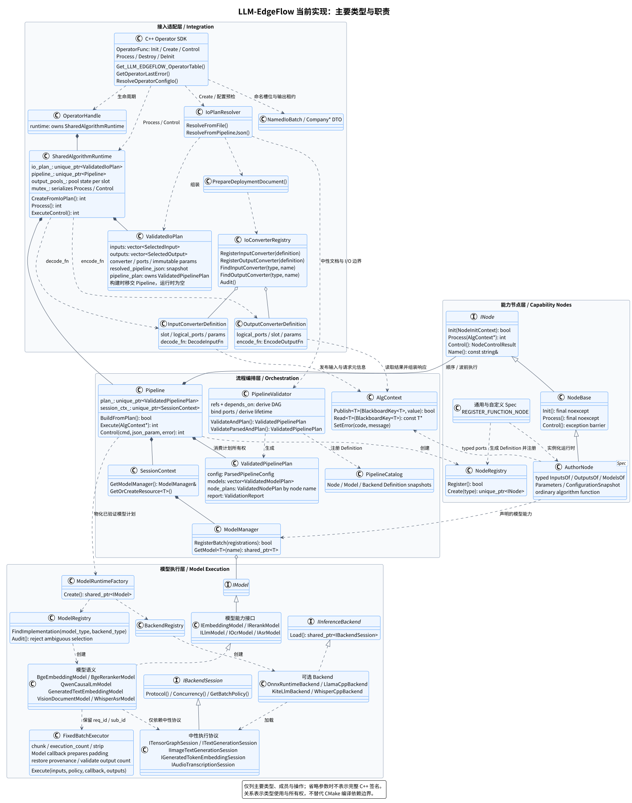
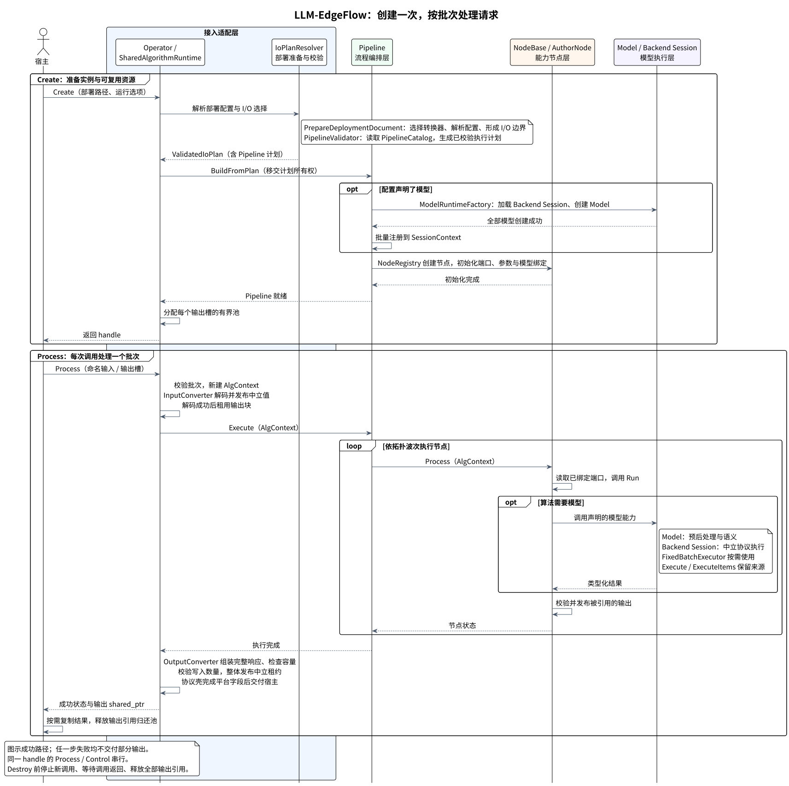

# LLM-EdgeFlow 架构设计

本文回答三个问题：功能应放在哪一层、实例创建时准备什么、每次请求如何执行。
首次运行见 [README](../README.md#快速开始)，接口细节按文中的链接查阅。

## 1. 架构总览

框架按职责分为四层。通常先组合已有节点，能力不足时再扩展对应层。

| 层 | 负责什么 | 主要源码 |
| :--- | :--- | :--- |
| 接入适配层 / Integration | 宿主协议、完整请求与响应转换、输出池与交付 | `include/edgeflow/operator/`、`include/adapter/`、`src/adapter/` |
| 流程编排层 / Orchestration | 校验执行计划、创建实例、调度节点、管理上下文 | `include/core/`、`src/core/` |
| 能力节点层 / Capability Nodes | 通用操作与可复用领域算法 | `include/nodes/`、`src/common_nodes/`、`src/custom_nodes/` |
| 模型执行层 / Model Execution | Model 预后处理与语义；Backend 运行时和设备资源 | `include/engine/`、`src/engine/` |

下面的箭头表示实现层的依赖方向，不表示每次请求都会经过模型。


共享运行时契约由 `edgeflow_runtime_contracts` 提供。Node 可以使用 `INode`、`AlgContext`
等获准的 Core 契约，但不能依赖 Core 的调度实现。编译边界见下文。

主要类型的归属与所有权如下；创建和请求的先后顺序见[调用时序](#3-创建与请求时序)。



图中省略具体业务 Node、Model 和 Backend 清单。可用实现随构建变化，查询目标构建：

```bash
./build/alg_pipeline_tool catalog
./build/alg_pipeline_tool plan configs/pipeline_keyword_match_rules.json
```

## 2. 职责与扩展边界

### 接入适配层（Integration）

外部契约包含载体中的业务字段、含义和序列化格式。即使复用同一个 C 结构，请求字段选择或
响应格式变化也属于 Adapter。Demo 只构造载体、调用 SDK、展示或复制结果。

#### 统一 Operator 门面与运行时架构

| 部件 | 职责 |
| :--- | :--- |
| C++ Operator 协议壳 | 解释公开 Create/Control 参数和命名 I/O，转换为中立调用，映射平台错误码 |
| 平台 binding | 校验载体、复制输入、分配和重置输出布局、处理平台内存 |
| Input / Output Converter | 解码完整请求、发布内部值；读取结果、组装完整响应并检查容量 |
| `SharedAlgorithmRuntime` | 准备部署、持有 Pipeline、调用转换器、管理输出池与租约、串行执行 Process/Control |

Runtime 属于接入层内部，不增加公开动态 ABI，也不解释平台字段。
Pipeline 根 `io.input` / `io.output` 按 `(type, name)` 选择转换器，每份登记拥有一个宿主槽位、
不可变参数及类型端口。这些端口组成 Core 的明确 I/O 边界。
业务参数在创建时解析；请求期不重复解析配置。

标准 C++ Operator API（`llm_edgeflow::operator_api`）是唯一公开算法接口。
当前外网构建导出三个 Operator 函数：`Get_LLM_EDGEFLOW_OperatorTable`、
`GetOperatorLastError`、`ResolveOperatorConfigIo`，以及两个日志等级函数
`AlgBase_setLogLevelByName`、`AlgBase_getLogLevelByName`。
函数表指针类型不带 `noexcept`，实现保留 `noexcept`、`catch (const std::exception&)`
和 `catch (...)` 屏障。Node、Registry、Model、Backend 及第三方运行时符号均隐藏。
共享库为 `libllm_edgeflow_sdk.so`，不带 SOVERSION，导出符号不带版本节点。

#### 接入契约原则及原因

- **输入先转换为拥有所需数据的中立值。** 图像从宿主像素帧进入，binding 校验尺寸、步长和容量后
  复制为 `ImageFrame`。文件读取属于 Demo 等调用方，Model 负责模型所需的预处理。
- **批次行位置关联请求与响应。** `inputs[i]` 对应 `outputs[i]`。可选输出不能压缩行；
  内部 `(req_id, sub_id)` 用于拆分、聚合和回填，不是外部业务 ID。
- **成功后整体交付。** Runtime 完成所有输出编码和数量校验后发布中立租约；
  协议壳完成全部平台字段后交付宿主。失败归还租约，不暴露部分结果。
- **平台定义止于接入层。** Converter 使用中立值，Core、Node、Model、Backend 不依赖平台载体。
  内部使用框架错误码，协议壳按失败类别映射平台码。
- **mock 只用于开发验证。** `include/platform_mock/` 是外网替身，具体协议壳位于
  `src/adapter/operator/mock/`。真实 SDK 的头文件、枚举、布局和所有权需在授权内网核验。

修改这些边界需遵循 [CONTRIBUTING](../CONTRIBUTING.md#3-design-and-current-contracts)。
转换器实现见[业务接入指南](dev_guide/business_onboarding.md)；槽位、容量和宿主生命周期见
[Operator 调用规则](dev_guide/operator_output_allocation.md)；错误映射见[错误码与日志](dev_guide/error_handling.md)。

### 流程编排层（Orchestration）

`PipelineValidator` 是依赖推导和校验的唯一实现：从 `inputs` 的 `节点.端口` 引用推导数据依赖，
加入可选 `depends_on` 顺序约束，检查类型、必需端口、DAG 和并行条件，生成 `ValidatedPipelinePlan`。
`Pipeline::BuildFromPlan` 接管计划所有权，不重新解析或排序。
`max_parallel_workers` 默认 1；更大值只有在通过并行安全检查后才启用。

创建前，接入层的 `PrepareDeploymentDocument` 选择转换器、解析 Pipeline 配置并形成
`PipelineIoBoundary`。`IoPlanResolver` 将解析结果交给 `ValidateParsedAndPlan`，组装 `ValidatedIoPlan`。
模型文件及声明为文件的参数相对 Pipeline JSON 目录解析；部署 `.conf` 只用 `pipe_path` 定位方案。

| 对象 | 生命周期与用途 |
| :--- | :--- |
| `SessionContext` | Pipeline 实例内的模型与资源缓存；`ModelManager` 管理模型，类型资源支持同 key 单次并发创建 |
| `AlgContext` | 每次 Process 批次新建的黑板；类型端口只发布一次，读取视图在本次请求内稳定 |
| `TraceableItem<T>` | 携带批内 `req_id` 和分片 `sub_id`，用于拆分后的对齐与聚合 |
| `NodeRegistry` | Core 所有的 Node 工厂注册表；根据类型创建 `INode` |

`SessionContext` 的资源缓存不等于通用跨请求业务状态机制。
Node 的请求数据仍放在本次 `AlgContext` 或局部变量中。

`PipelineCatalog` 汇集 Node、Model、Backend 的 Definition 快照，Validator 读取快照生成计划。
**转换器注册由接入层管理**：`IoCatalog` 补入 I/O Definition 后，工具才得到完整 Catalog。
工具与文档不能另写一份能力或配置校验规则。

### 能力节点层（Capability Nodes）

通用与自定义 Node 使用同一结构：普通算法函数，加 `Inputs / Params / Models / Run / Spec`，
通过 `MakeNodeSpec` 和 `REGISTER_FUNCTION_NODE` 登记。
`INode` 是 Core 定义的运行时接口；`NodeBase` 和 `AuthorNode<Spec>` 属于能力节点层，
负责初始化、异常屏障、端口读写、结果检查和配置快照。

Node 只使用类型端口和声明的模型能力。请求数据不保存在 Node 实例中，输出只在被引用时发布，
输出生命周期由 Validator 推导。通用 Node 提供中立框架操作；领域算法放在
`src/custom_nodes/`，按操作组织并跨方案复用，不必为单个算法增加泛化框架。
Core、Engine 和通用 Node 不依赖具体自定义实现。

开发步骤见[第一个自定义 Node](dev_guide/first_custom_node.md)，
端口、参数、模型绑定与并发见[Node 常用写法](dev_guide/custom_node_concepts.md)。

### 模型执行层（Model Execution）

- **Model 负责语义。** Node 通过 `ILlmModel`、`IEmbeddingModel`、`IRerankModel`、`IOcrModel`
  或 `IAsrModel` 调用能力。Model 处理提示词、分词、图像/音频预处理和输出解释。
- **Backend 负责执行。** `IInferenceBackend::Load` 加载厂商资源并返回中立 Session。
  Model 只依赖 TensorGraph、TextGeneration、ImageTextGeneration、GeneratedTokenEmbedding
  或 AudioTranscription 协议，不包含厂商头文件。
- **创建时确定兼容性。** 模型类别与 Backend 协议选择唯一实现；注册审计和 Core 都拒绝歧义。
  `ModelRuntimeFactory` 创建模型及会话，全部成功后 Pipeline 批量注册模型，再初始化 Node。
- **批策略属于 Session。** `FixedBatchExecutor::Execute` 按策略切批，由 Model 回调准备补齐输入，
  执行器剔除补齐输出、恢复来源并在失败时清空结果。动态会话的一输入一输出模型可用
  `ExecuteItems` 复用同样的数量、来源和失败处理；它不接受固定批策略。

默认构建启用 Inferlet。ONNX Runtime、llama.cpp、Kite 和 whisper.cpp 按构建选项启用，
部分组合互斥，见[构建变体](VERIFIABLE_SELECTION.md#构建变体)。
`ComputePlatform` 中有某个平台枚举不代表当前构建具备对应实现或已在目标设备验收。
更换配置中的 Backend 还必须满足协议、模型格式和设备兼容性。

Kite 图像转写只产出文本，不伪造检测框或置信度；生成 token 向量也不等同于 BGE 向量空间。
相关部署与限制见 [Kite 使用说明](kitellm.md)，模型扩展见[开发者指南](developer_guide.md)。

### 编译期边界与 Composition Root

`cmake_ext/RuntimeGraph.cmake` 定义分层目标，`ProductTargets.cmake` 组合 SDK、工具与测试。
四层分别使用 `edgeflow_integration_objects`、`edgeflow_orchestration_objects`、
`edgeflow_capability_nodes_objects`、`edgeflow_model_execution_objects`；公共装配使用
`edgeflow_composition_objects`。最终产物聚合对象，不重新声明层内源码。

Backend 另由 `edgeflow_model_execution_backends_objects` 编译。厂商头、`HAVE_*` 宏和第三方
编译选项限定在该目标；最终产物通过 `LINK_ONLY` 获得链接依赖，其他层不继承厂商编译环境。

各层使用受限 include view。公开 SDK 调用头、源码扩展契约和内部实现头分开，具体清单见
[源码布局](dev_guide/source_layout.md)。Node 可用的 Core 契约由
`cmake_ext/support/node_core_contracts.txt` 列举，CMake 与 LayerGuard 共用。
静态依赖检查和实际编译测试共同验证边界，不能仅靠 include 搜索路径阻止越层引用。
每个构建由 `EDGEFLOW_OPERATOR_SHELL` 选择一套协议壳及其测试和 Demo 夹具，见
[Operator 壳选择](dev_guide/source_layout.md#operator-壳选择)。

## 3. 创建与请求时序

创建时完成配置校验、模型加载、节点初始化和输出池分配。每次 Process 复用这些资源，
新建请求上下文，依次解码、执行和编码。无需模型的 Pipeline 省略模型调用。



图示全局 Init 成功后的实例创建与请求成功路径。节点按拓扑波次执行，
同一波内只有符合并行条件的节点才可并行。
同一 handle 的 Process/Control 串行，不同 handle 可并行。
销毁前须停止新调用、等待在途调用返回并释放全部输出引用；详见
[宿主调用与生命周期](dev_guide/operator_output_allocation.md#宿主调用与生命周期)。

## 4. 开发入口

| 需求 | 入口 |
| :--- | :--- |
| 组合已有算法、换提示词或兼容权重 | [Studio 编排练习](../tools/pipeline_studio/README.md#第一次编排) · [配置目录](../configs/README.md) |
| 增加请求/响应契约 | [业务接入指南](dev_guide/business_onboarding.md) |
| 增加领域算法或运行时控制 | [自定义 Node 入门](dev_guide/first_custom_node.md) · [Control 入门](dev_guide/first_control.md) |
| 扩展 Core、Model 或 Backend | [开发者指南](developer_guide.md) |
| 准备构建、模型和验收数据 | [验证范围与操作](VERIFIABLE_SELECTION.md) |

配图源文件与生成方法见[文档目录](README.md)。
