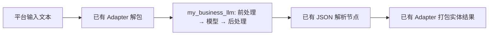

# 第一个自定义 Node：先写两段文本处理，再接入方案

本练习实现“输入处理 → 调用模型 → 输出处理”，并通过 Demo 运行。
先按 [README](../../README.md#快速开始)完成构建，所有命令在仓库根目录执行。
本例使用固定回答的测试模型，无需下载权重。

已有节点能满足需求时直接配置 Pipeline。需要写代码时，可按本文逐步接入；
希望自动生成方案与验证命令，可使用[文本 LLM Recipe](recipe_text_llm_node.md)。
纯计算 Node 使用[普通脚手架](../../src/custom_nodes/README.md#通用开发步骤速查)。

## 1. 先认清今天要改的范围

本练习使用既有模型能力和实体输入输出结构，只修改：

| 文件 | 你要做什么 |
| --- | --- |
| `src/custom_nodes/my_business_llm_node.cpp` | 脚手架生成后，填写两个文本函数 |
| `tests/unit/nodes/test_my_business_llm_node.cpp` | 核对业务输出，并补充修改后的行为断言 |
| `demo/fixtures/mock/pipeline_first_node.json` | 在复制的方案中选用新节点 |
| `demo/fixtures/mock/pipeline_first_node.conf` | 用 `pipe_path` 指向新方案 |

先关注 `BuildPrompt` 和 `FormatAnswer` 两个文本函数。框架负责模型加载、调度和数据传递；
外部请求与响应由 Adapter 转换。

## 2. 生成自己的节点

生成源码与测试：

```bash
./tools/scaffold_custom_node.py my_business_llm --kind model -m llm --write-test
```

打开 `src/custom_nodes/my_business_llm_node.cpp`。文件中的主要内容分成四部分：

| 位置 | 第一次开发时怎么处理 |
| --- | --- |
| 顶部 `BuildPrompt` / `FormatAnswer` | 填写业务逻辑：接收一个字符串，返回一个字符串 |
| `Inputs` / `Models` / `Run` | 逐条调用 `BuildPrompt`，整批调用一次模型，再逐条调用 `FormatAnswer`；第一次不用改 |
| `Spec` | 用 `MakeNodeSpec` 声明输入输出、生成参数和模型 |
| `REGISTER_FUNCTION_NODE` | 从同一 Spec 注册构造方法和 Definition |

## 3. 只修改两个函数体

在 `BuildPrompt` 中，将默认的 `return text;` 换成下面这行，给模型输入加上任务指令：

<!-- starter-example:BuildPrompt -->
```cpp
return "你是实体与名词抽取助手。请返回 JSON。\n" + text;
```

在 `FormatAnswer` 中，将默认的 `return text;` 换成下面几行，去掉回答末尾的换行：

<!-- starter-example:FormatAnswer -->
```cpp
std::string answer = text;
while (!answer.empty() && answer.back() == '\n') answer.pop_back();
return answer;
```

你只处理 `text`；框架自动保留每条输入与回答的对应关系，无需在业务函数中传递或填写来源编号。前处理从只读输入构造新文本，不修改其他节点共享的输入。

本练习的测试模型通过短语 `实体与名词抽取助手` 返回固定 JSON；保留该短语才能接到后续
JSON 解析节点。它验证接入流程，真实提示词的效果需换用真实模型评估。

在生成的测试文件中，将 `RecordingModel` 返回的 `"fixture text"` 改为 `"fixture text\n"`，
输出断言仍保留 `"fixture text"`，用于检查刚添加的末尾换行清理。

## 4. 编译，让工具能够找到新节点

源码格式化需要 clang-format 18。

```bash
./scripts/format.sh
cmake --build build --target alg_sdk alg_pipeline_tool alg_pipeline_tool_test alg_demo edgeflow_test_nodes_runner -j 4
./build/edgeflow_test_nodes_runner --gtest_filter='ScaffoldGeneratedNodeTest.my_business_llm_*'
./build/alg_pipeline_tool describe-node my_business_llm
```

Catalog 应显示 `my_business_llm`，输入输出为 `TextBatch`。

## 5. 复用已有方案和 Adapter

复制这两份已存在的配置，避免从空白文件猜业务输入输出：
如果已有同名练习文件，继续编辑它们即可，不必重新复制。

```bash
cp demo/fixtures/mock/pipeline_entity_extract_custom.json demo/fixtures/mock/pipeline_first_node.json
cp demo/fixtures/mock/pipeline_entity_extract_custom.conf demo/fixtures/mock/pipeline_first_node.conf
```

编辑 `pipeline_first_node.json` 中 `name` 为 `generate_entities` 的节点，做两处修改：

- `type` 改成 `my_business_llm`。
- 将整个 `params` 对象替换为下面的内容。新节点声明了模型绑定和 `max_tokens`、`temperature`
  等生成参数（不写时使用默认值），不接受完整样例的模板和清洗字段。

```json
{"bind_model": "entity_llm"}
```

保留 `inputs`、模型、JSON 解析节点和 `io` 连线。
将 `pipeline_first_node.conf` 的 `pipe_path` 改为 `pipeline_first_node.json`。

此时数据经过：



`"inputs":{"input":"input.sentence_text"}` 将节点的 `input` 端口连接到输入转换器。
后续节点通过 `generate_entities.output` 读取结果；`io.output` 选择最终回包来源。

## 6. 校验并运行同一个 Demo

```bash
./build/alg_pipeline_tool_test validate demo/fixtures/mock/pipeline_first_node.json
./build/alg_pipeline_tool_test plan demo/fixtures/mock/pipeline_first_node.json
./build/alg_demo --config demo/fixtures/mock/pipeline_first_node.conf --dataset data/corpus_entity_extract.txt --output-dir results/first-node
```

这些配置使用测试模型，校验要用带测试注册的 `alg_pipeline_tool_test`。
`alg_pipeline_tool` 用于查看生产注册，也能发现刚编译的自定义节点。

查看 `results/first-node/pipeline_first_node/results.jsonl`：第一条记录应有 `status: 0`，
以及 `output.nouns: ["mock entity"]`。`summary.json` 应显示一条成功、
零条失败。这里验证节点、编排与 Adapter 的完整路径，回答来自确定性测试模型。

替换真实模型时，按目标构建的 Catalog 更新 `models` 和资产路径，节点的 `bind_model`
引用相应 `name`。再用自己的输入与期望结果验收，不能把测试模型回答作为效果指标。

## 7. 从练习进入真实开发

在生成的测试中补充自己的业务预期，检查提示词、结果与来源；参考
[LLM Node 测试](../../tests/unit/nodes/test_llm_generate_node.cpp)。
交付前执行 `./scripts/run_all_tests.sh`，流程见 [CONTRIBUTING](../../CONTRIBUTING.md)。

| 接下来遇到的问题 | 去哪里看 |
| --- | --- |
| 端口、编号、模型绑定、Definition、并发是什么意思 | [按需参考](custom_node_concepts.md) |
| 需要多个输入或条件重试 | [多输入 starter](../../dev_support/node_authoring/starter_batch_node.cpp) |
| 需要 LLM 与 Embedding 两种能力 | [多模型 starter](../../dev_support/node_authoring/starter_multi_model_node.cpp) |
| 需要配置化模板或复杂后处理 | [复杂算法的组织与现有辅助函数](custom_node_concepts.md#复杂算法仍按普通-c-函数组织) |
| 需要接入全新的平台结构 | [业务接入指南](business_onboarding.md) |
| 需要新增模型语义或硬件后端 | [开发者扩展指南](../developer_guide.md) |

练习生成的节点与配置就是普通源码扩展。真正接入时用操作语义命名，例如“识别实体”或
“核对条件”，避免把项目名固化进节点或为每个业务再建目录。
