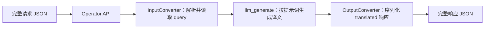

# JSON 字符串翻译方案

本方案遵循[统一接入约定](../dev_guide/business_onboarding.md)。
Operator 接收完整 JSON 请求。InputConverter 提取 `query`，模型按提示词生成简体中文译文。
OutputConverter 将模型文本写入 `translated` 字符串，并返回完整 JSON 响应。
`version`、`endpoint`、`src_lan` 和其他字段不参与路由、类型检查或提示词构造。

## 直接调用 Operator API

部署配置为 `configs/pipeline_translate_cpu.conf`，指向同名 Pipeline JSON。
该 Pipeline 在 `io` 中选择输入 `entity_in/translate` 和输出 `json_out/translate`。
输出默认容量为 8191 字节。
输入复用实体输入载体的 `sentence_text` 字段。输出使用统一 C 结构 `CompanyOperatorOutput` 的 `result_json` 字段。
传入的是完整对象文本，不是 `query` 子串，也不是双重 JSON 编码后的字符串：

```cpp
auto op = llm_edgeflow::operator_api::Get_LLM_EDGEFLOW_OperatorTable();
op.Init();

llm_edgeflow::operator_api::CreateParam create{};
create.model_path = ".";
create.cfg_file_name = "configs/pipeline_translate_cpu.conf";
create.compute_platform = llm_edgeflow::operator_api::ComputePlatform::kCpu;

void* handle = nullptr;
op.Create(&handle, &create);

std::string req_json = "{\"version\":\"0.0.1\",\"endpoint\":\"translate\","
                       "\"query\":\"hello,what is your name\",\"src_lan\":\"en\"}";
CompanyString cs{static_cast<int32_t>(req_json.size()), const_cast<char*>(req_json.data())};
CompanyOperatorEntityInput input{1, &cs};

llm_edgeflow::operator_api::NamedIoBatch inputs(1);
inputs[0]["trans.entity_in"] = llm_edgeflow::operator_api::MakeBorrowedOperatorInput(&input);

llm_edgeflow::operator_api::NamedIoBatch outputs(1);
outputs[0]["trans.json_out"] = nullptr;

int ret = op.Process(handle, inputs, outputs);
/* ret == 0 时，outputs[0]["trans.json_out"] 指向 CompanyOperatorOutput，
   其 result_json 是完整的 {"translated":"..."}，status_code 保存状态。
   复制需要的值，重置 outputs/租约后，调用 op.Destroy(handle)、op.DeInit()。 */
```

`input.sentence_text` 的实际内容是：

```json
{"version":"0.0.1","endpoint":"translate","query":"hello,what is your name","src_lan":"en"}
```

Qwen2.5 0.5B Q4_K_M / llama.cpp CPU 的一次运行结果如下。具体措辞可能变化。

```json
{"translated":"你好，你叫什么名字？"}
```

## Demo

本方案需要 llama.cpp。默认 Inferlet 构建未启用 llama.cpp。
在仓库根目录显式启用 llama.cpp 并重建，使下面命令使用的 `build/` 包含该后端：

```bash
cmake --preset=minimal -B build -DENABLE_LLAMACPP=ON
cmake --build build --target alg_sdk alg_pipeline_tool alg_demo --parallel 4
```

权重为 `configs/qwen2.5-0.5b-instruct-q4_k_m.gguf`，缺失时可沿用
`./scripts/fetch_real_test_models.sh --gguf-only`。来源及校验以
[资产清单](../../configs/asset_manifest.json)为准。

```bash
python3 demo/json_prompt_demo.py --input '{"version":"0.0.1","endpoint":"translate","query":"hello,what is your name","src_lan":"en"}'
python3 demo/json_prompt_demo.py --dataset data/corpus_translate.jsonl
```

stdout 每行输出一个完整响应 JSON。stderr 输出日志路径。
Python 程序将请求对象写成单行，保留全部字段和值。SDK 响应按原样输出。`results/translate/run-*` 保存
`input.txt`（完整请求）、`demo.log` 和 `results/translate/` 下的原生结果/汇总。
也可通过 stdin 输入一个完整请求，或用 `--output-dir` 指定保存目录。

统一 Demo 走 Operator 外观：

```bash
./build/alg_demo --config configs/pipeline_translate_cpu.conf \
  --dataset data/corpus_translate.jsonl --output-dir results/translate-native
```

上面的 Operator 示例和测试单独证明 Operator 接口的行为。

## 复用范围与处理边界



- [Translate InputConverter](../../src/adapter/input/translate_json_input.cpp) 与 [OutputConverter](../../src/adapter/output/translation_json_output.cpp)
  复用 `entity_in` 输入载体与 `json_out` 统一输出载体和输出池，只增加 JSON 字段映射。统一 Demo 解析并展示完整响应。
- [Pipeline](../../configs/pipeline_translate_cpu.json)仅使用已有 `llm_generate`，
  直接将 `input.query` 原文传入模型，生成纯文本 `translate_text.text`。翻译规则放在节点
  `system_prompt` 参数中，由现有 C++ Model 组装对话提示词。每条请求只调用一次文本
  生成，没有格式修复或二次推理。自回归生成内部仍逐 token 解码。无关字段不会进入模型。
- [部署配置](../../configs/pipeline_translate_cpu.conf)定位 Pipeline，Pipeline 中选择 Qwen Model / llama.cpp
  Backend。翻译 JSON 的字段语义由 Integration 中的注册与转换实现。

输入必须是 JSON 对象且 query 是字符串。非法输入在 SDK 内报错。空串可通过接入校验，
但当前 Qwen Model 拒绝空原文并返回错误，不补造成功译文。
提示词要求模型只输出译文。C++ 负责 `{"translated":...}` 的字段和 JSON 转义。
Adapter 原样保存模型文本，不解析、裁剪或去掉引号。即使文本恰好像 JSON，也只是
`translated` 的字符串内容。输入与输出中的换行、引号、反斜杠和 NUL 通过解析/序列化保真。
无静态默认译文或成功 fallback。错误状态、来源异常或容量不足返回非零。

完整输入沿用 64 KiB 上限。
Operator 的 JSON 输出池在本配置中为 8191 字节。当前上下文为 2048 tokens、生成上限为
512 tokens，用于短文本演示。长文需调整并验证上下文、生成长度和输出容量。C++ 保证
响应格式，译文准确性、完整性和是否遵守提示词仍取决于模型。

## 验证与后续需求

```bash
./build/alg_pipeline_tool catalog
./build/alg_pipeline_tool validate configs/pipeline_translate_cpu.json
./build/alg_pipeline_tool plan configs/pipeline_translate_cpu.json
./build/alg_pipeline_tool resolve-conf configs/pipeline_translate_cpu.conf --root . --depth 1
./scripts/run_all_tests.sh
```

现有测试套件直接调用 Operator Process，使用计数测试模型验证原始 query 输入、
每条请求仅一次生成、C++ 组装完整响应，以及无关字段忽略、转义、失败与输出容量。
该测试不作为翻译质量证据。Python 测试验证完整对象转发和完整 SDK 响应转发。
真实模型验证使用同一份生产 Pipeline，执行三条样例的 Operator Demo。

运行后，检查 `ret`。再核对输入输出的行对应关系和每条响应的 `status_code`。
最后，用业务数据检查译文。
示例译文不代表其他权重或输入的效果。同句柄输入 `{"query":""}` 应返回错误而非成功响应。

复用相同输入/输出契约的新提示词方案只需改配置。改变 SDK 字段契约时，按
[业务接入指南](../dev_guide/business_onboarding.md)在 Integration 增加必要转换。
不要在 Demo 外预先提取字段来替代 Operator 能力。后续指导见
[json-prompt-solution skill](../../.agents/skills/json-prompt-solution/SKILL.md)。
